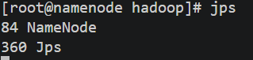
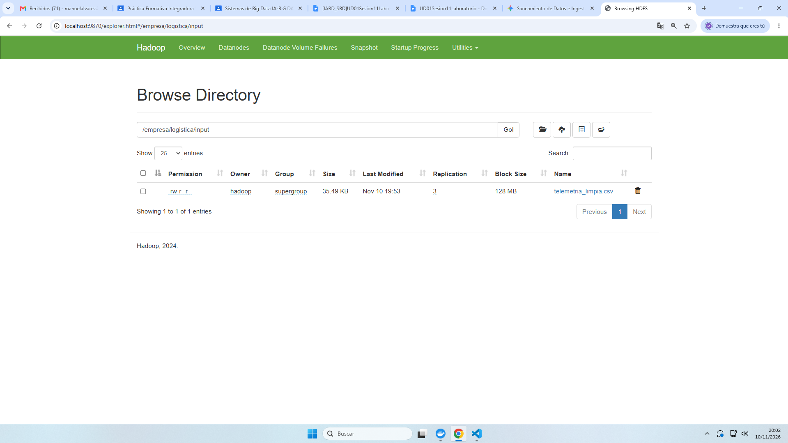

# Informe Técnico: Ingesta, Saneamiento y Almacenamiento Distribuido en HDFS

Este repositorio recoge el desarrollo, los scripts reproducibles y las evidencias técnicas de la práctica de saneamiento de datos de telemetría, verificación criptográfica de integridad y almacenamiento distribuido sobre Apache Hadoop (HDFS).

---

## 1. Integridad (Módulo 5075)

Para garantizar la calidad del conjunto de datos antes de su ingesta en el clúster, se desarrolló el script reproducible `scripts/normalizado.py`. Este proceso lee el fichero original (`datos/telemetria_envios.csv`) y aplica las siguientes reglas de depuración:
* Eliminación de registros duplicados y valores nulos (`NaN`).
* Filtrado de pesajes estrictamente positivos (`peso_kg > 0`).
* Filtrado de temperaturas dentro del rango operativo válido (`-30 °C` a `40 °C`).
* Validación de estados de envío frente al catálogo oficial (`ENTREGADO`, `EN_TRANSITO`, `EN_REPARTO`, `INCIDENCIA_REPARTO`).

### Registro comparativo de hashes SHA-256

Con el objetivo de auditar la trazabilidad e inmutabilidad de cada versión del fichero, se calculó la firma criptográfica **SHA-256** antes y después del tratamiento:

| Versión del Dataset | Fichero | Filas | Hash SHA-256 |
| :--- | :--- | :---: | :--- |
| **Original (sin depurar)** | `datos/telemetria_envios.csv` | `<N_FILAS_INICIALES>` | `<PEGAR_HASH_ORIGINAL_SHA256>` |
| **Depurado (saneado)** | `datos/telemetria_limpia.csv` | `<N_FILAS_FINALES>` | `<PEGAR_HASH_LIMPIO_SHA256>` |

La variación completa entre ambas firmas SHA-256 demuestra el efecto avalancha propio de las funciones hash criptográficas: al descartar los registros anómalos, el contenido binario del dataset se transforma por completo, dejando constancia verificable de que el fichero ingestado en HDFS corresponde exactamente a la versión saneada.

### Comprobante textual del cálculo de integridad

```text
<PEGAR AQUÍ COMPLETA DE DE: EJECUCIÓN LA SALIDA python scripts/normalizado.py>
```

---

## 2. Despliegue y HDFS (Módulo 5074)

### Verificación del contenedor y arquitectura de despliegue
El clúster Hadoop se desplegó mediante Docker Compose a partir de la imagen `apache/hadoop:3.4.0` (base CentOS 7). Para auditar los demonios JVM activos dentro del contenedor `namenode`, se redirigieron los repositorios EOL de CentOS 7 hacia `vault.centos.org` y se instaló el paquete `java-11-openjdk-devel`, habilitando la herramienta `jps` para confirmar la ejecución de `NameNode` (y `DataNode` en su contenedor correspondiente). Asimismo, se verificó con `hdfs dfsadmin -fs hdfs://namenode:9000 -report` y `-safemode get` que el modo seguro estuviera desactivado (`Safe mode is OFF`) y que existiera al menos un nodo de almacenamiento activo (`Live datanodes (1)`).

### Puertos mapeados

| Puerto Host | Puerto Contenedor | Servicio / Protocolo | Función |
| :---: | :---: | :--- | :--- |
| **`9870`** | `9870` | NameNode WebUI (HTTP) | Interfaz gráfica de administración y explorador de HDFS. |
| **`9000`** | `9000` | NameNode RPC / IPC | Punto de acceso al sistema de archivos distribuido (`hdfs://namenode:9000`). |
| **`9864`** | `9864` | DataNode WebUI / HTTP | Interfaz de estado del nodo de datos y transferencia de bloques. |

### Comandos HDFS ejecutados

Tras copiar el fichero saneado al contenedor (`docker cp datos/telemetria_limpia.csv namenode:/tmp/telemetria_limpia.csv`), se ejecutó el flujo de creación de directorios, carga distribuida, inspección de contenido y auditoría física de bloques:

```bash
# 1. Creación de la estructura de directorios en HDFS
hdfs dfs -mkdir -p hdfs://namenode:9000/empresa/logistica/input

# 2. Ingesta del dataset saneado en HDFS
hdfs dfs -put /tmp/telemetria_limpia.csv hdfs://namenode:9000/empresa/logistica/input/

# 3. Verificación del fichero y metadatos en el directorio de destino
hdfs dfs -ls hdfs://namenode:9000/empresa/logistica/input/

# 4. Previsualización de las primeras líneas almacenadas en HDFS
hdfs dfs -head hdfs://namenode:9000/empresa/logistica/input/telemetria_limpia.csv

# 5. Auditoría de salud, bloques físicos asignados y ubicación en DataNodes
hdfs fsck hdfs://namenode:9000/empresa/logistica/input/telemetria_limpia.csv -files -blocks -locations
```

### Registro de ejecución de comandos HDFS

```text
<PEGAR -ls AQUÍ COMANDOS DE LA LOS SALIDA TEXTUAL Y dfs fsck hdfs>
```

---

## 3. Análisis crítico

> **Cuestión:** *“¿Por qué un fichero en HDFS no se corrompe ni se pierde aunque falle o se apague un DataNode en un clúster de producción?”*

En un clúster de producción, HDFS evita la pérdida de datos mediante una arquitectura basada en la **fragmentación en bloques** (por defecto de 128 MB) y la **replicación distribuida** gestionada por el NameNode. Cuando un fichero se escribe en HDFS, cada bloque no reside en un único servidor, sino que se copia de forma automática en varios DataNodes distintos siguiendo un factor de replicación configurable (habitualmente `dfs.replication = 3`) y políticas de conciencia de rack (*rack-awareness*). De este modo, las réplicas quedan repartidas entre diferentes nodos físicos e incluso distintos bastidores de red, garantizando que el apagado repentino o la avería de hardware de un DataNode nunca deje al fichero sin copias disponibles.

La detección y recuperación ante caídas se realiza de manera autónoma gracias al intercambio continuo de mensajes de control entre los nodos. Cada DataNode envía periódicamente señales de latido (*heartbeats*) y reportes de estado de bloques (*block reports*) al NameNode; si un DataNode deja de responder durante el tiempo límite configurado, el NameNode lo marca como caído (*dead node*). Inmediatamente, el NameNode consulta sus metadatos para identificar qué bloques han quedado por debajo de su factor de replicación objetivo (*under-replicated blocks*) y ordena a los DataNodes sanos que poseen copias válidas que clonen esos bloques hacia otros servidores activos del clúster, restaurando la redundancia completa sin intervención manual ni interrupción para los clientes.

Por otro lado, frente a la corrupción silenciosa de datos en disco (*bit-rot*) o fallos durante la transferencia por red, HDFS protege la integridad mediante **sumas de comprobación criptográficas (checksums CRC-32)**. Durante la escritura inicial, el cliente calcula y almacena un *checksum* por cada fragmento de datos junto al bloque en el DataNode. Cada vez que una aplicación lee el fichero, vuelve a calcular el *checksum* de los bytes recibidos y lo contrasta con el original: si detecta una discrepancia, el bloque se marca como corrupto, la lectura se redirige de forma transparente hacia otra réplica sana en otro DataNode y el NameNode programa el borrado del bloque dañado y la generación de una nueva réplica íntegra.

---

## 4. Evidencias gráficas

Todas las capturas de verificación se encuentran almacenadas en el directorio `/evidencias`:

### 4.1. Cálculo de checksums SHA-256

*Evidencia `01_hashes_sha256.png`: Ejecución de `scripts/normalizado.py` mostrando los hashes SHA-256 antes y después del saneamiento junto con el conteo de registros filtrados.*

### 4.2. Servicios activos en el contenedor Hadoop (`jps`)

*Evidencia `02_jps_servicios.png`: Salida del comando `jps` dentro del contenedor verificando la ejecución de los procesos JVM de Hadoop.*

### 4.3. Ingesta HDFS y auditoría de bloques (`fsck`)

*Evidencia `03_hdfs_comandos_fsck.png`: Ejecución de `hdfs dfs -put`, listado con `hdfs dfs -ls` y diagnóstico de bloques y ubicación en el DataNode mediante `hdfs fsck`.*

### 4.4. Explorador web del NameNode (WebUI)

*Evidencia `04_webui_hdfs_browse.png`: Verificación visual desde `http://localhost:9870` (`Utilities -> Browse the file system`) del fichero `telemetria_limpia.csv` alojado en `/empresa/logistica/input/`.*
